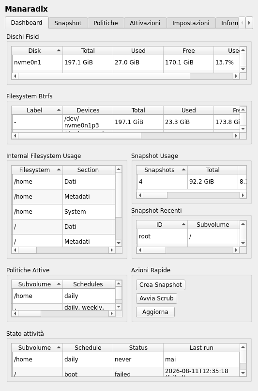
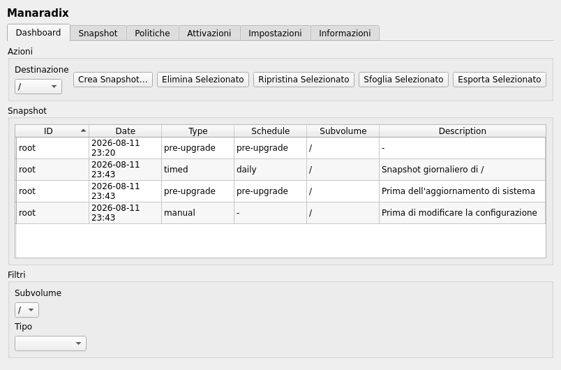
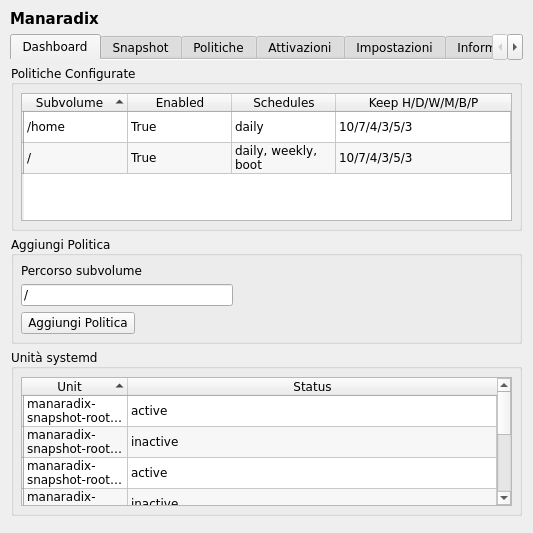
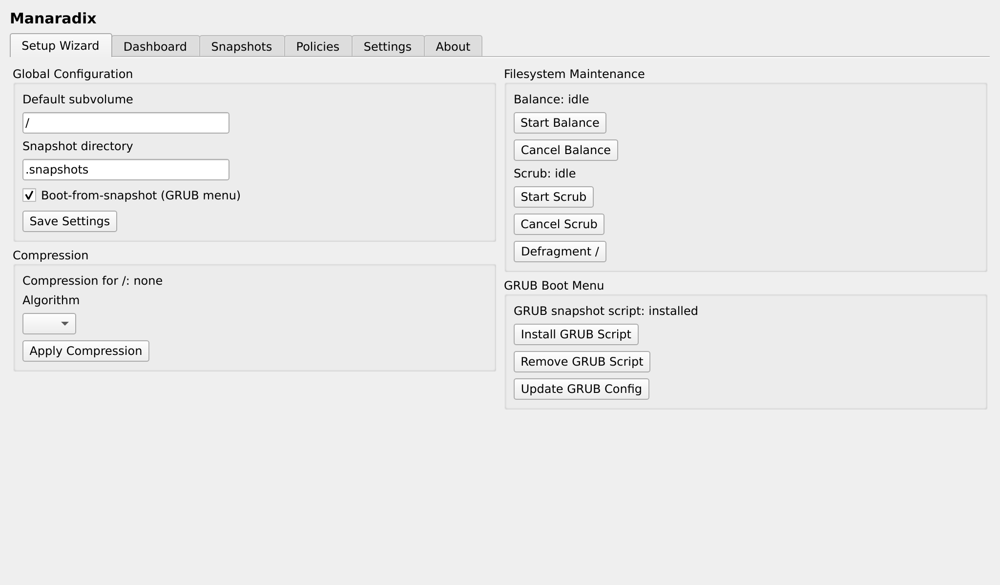
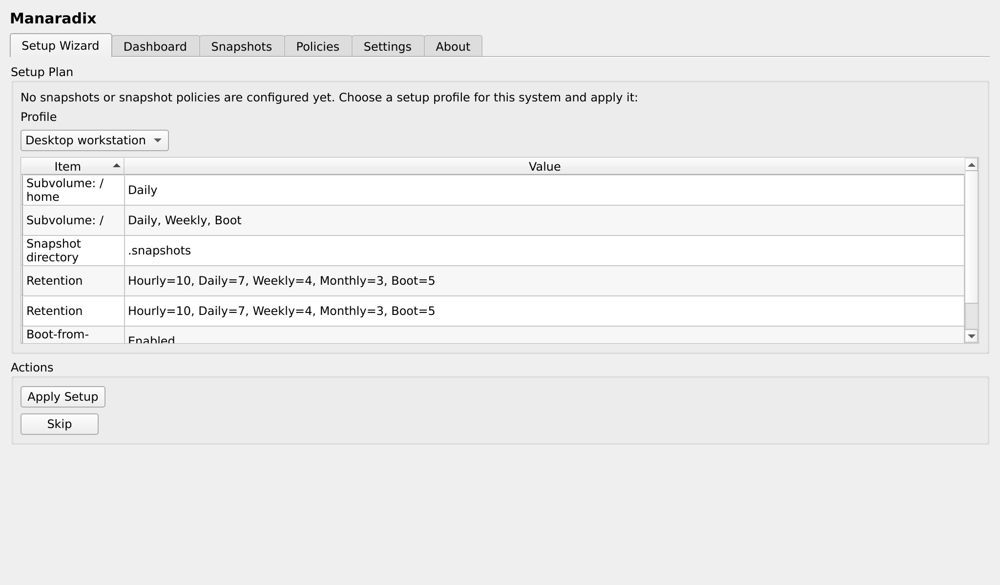
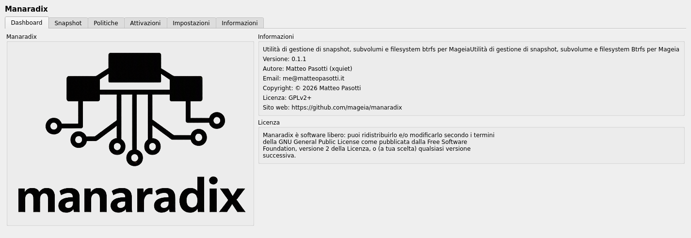

# Manaradix — Btrfs Snapshot Management for Mageia

A system utility for **Mageia 10** and **Cauldron** providing a unified
graphical and text interface for managing Btrfs snapshots, subvolumes,
and filesystem parameters. Built on top of `python-manatools` using the `aui`
(Abstract UI) backend so a single codebase renders in Qt, GTK, and ncurses
frontends.

Conceptually similar to openSUSE's `btrfsmaintenance` + `btrfs-assistant` and
Garuda's `btrfs-assistant`, but tailored to Mageia's infrastructure and
packaging conventions.

The Qt frontend. The same pages render in GTK and ncurses.

| Dashboard | Snapshots |
|---|---|
|  |  |

| Policies | Settings |
|---|---|
|  |  |

| Setup Wizard | About |
|---|---|
|  |  |

## Feature overview

- **Snapshot management** — create, list, inspect, delete, prune, rename,
  restore, browse, export (send) and import (receive) btrfs snapshots,
  with JSON sidecar metadata under `<mount>/.snapshots/<timestamp>/`.
- **Automated snapshots** — generated systemd timer/service units per
  subvolume and schedule (hourly, daily, weekly, monthly, boot), with
  retention-based pruning. See [Automated snapshots](automated-snapshots.md).
- **Boot from snapshot** — an `/etc/grub.d/41_manaradix` script adds a
  GRUB recovery submenu listing read-only snapshots. See
  [Boot from snapshot](boot-from-snapshot.md).
- **Pre-upgrade snapshots** — an rpm file trigger snapshots the root
  subvolume before every package transaction. See
  [Pre-upgrade snapshots](pre-upgrade-snapshots.md).
- **Setup wizard** — first-run detection and one-click profile application
  (desktop, server, kiosk). See [Setup profiles](profiles.md).
- **D-Bus service** — a bus-activated system service exposing the same
  operations programmatically, gated by polkit. See
  [D-Bus interface](api/dbus.md).
- **Tray applet** — a notification-area watchdog (same package,
  autostarts at login) that notifies about low disk space, btrfs error
  counters and SMART health, and snapshots due for pruning. See
  [Tray applet](tray-applet.md).
- **Three frontends** — Qt, GTK, and ncurses from a single declarative UI
  layer (`manatools.aui`).

## Documentation map

| Where | What |
|---|---|
| [Install](install.md) | Installing from Mageia repositories |
| [Quick start](quickstart.md) | Launching the GUI and the setup wizard |
| [CLI reference](cli.md) | Every command, option, and exit code |
| [Configuration](configuration.md) | `/etc/manaradix/config.toml` reference |
| [D-Bus interface](api/dbus.md) | Service, methods, polkit tiers |
| [API reference](api/python.md) | Python API, generated from docstrings |
| [Development](development.md) | Building, testing, translating |
| [Design & internals](activities.md) | How the schedule/activity machinery works |
| [Roadmap & issues](SECURITY_AND_PERFORMANCES.md) | Living security/perf/feature tracker |

The full technical specification lives in
[`spec.md`](https://bitbucket.org/_pmat_/manaradix/src/master/spec.md) at
the repository root.
